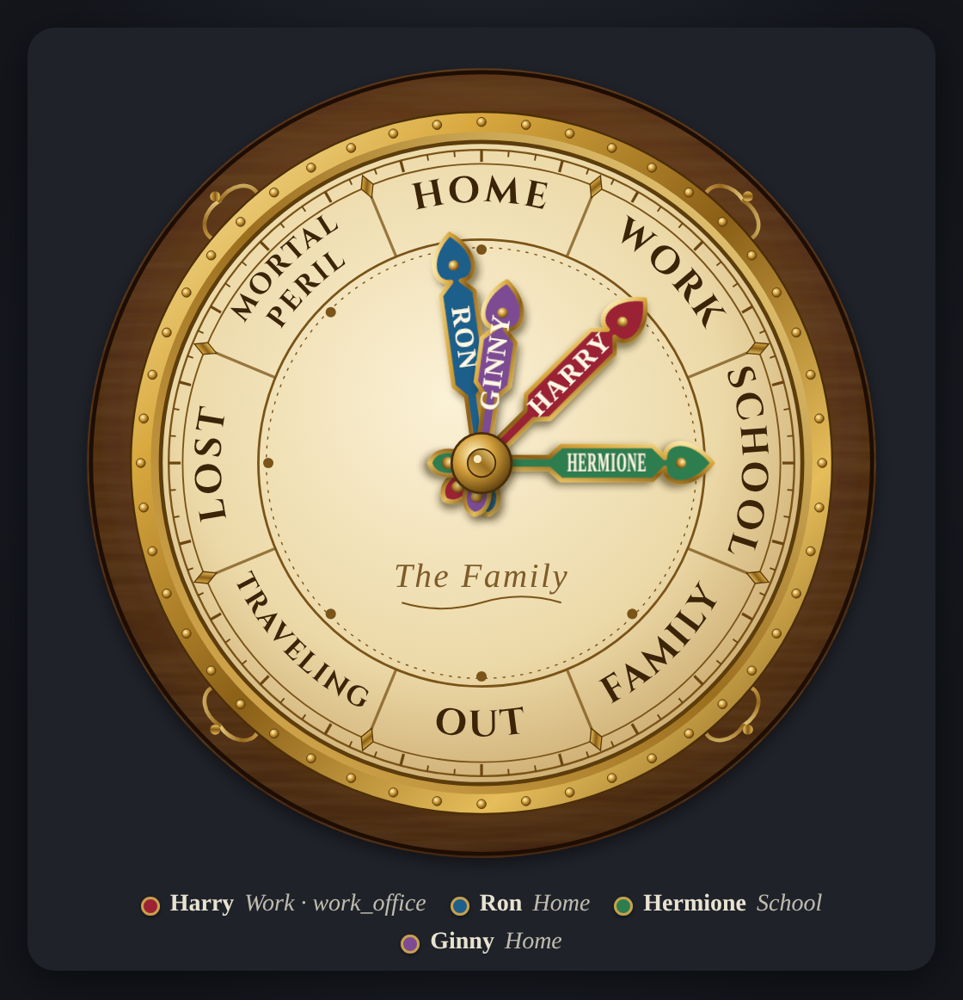

# Home Assistant Weasley Clock

A Harry Potter–style family location clock as a vanilla Lovelace custom card.
Each person's hand points to **Home**, **Work**, **School**, **Family**, **Out**,
**Traveling**, **Lost**, or **Mortal Peril** (battery under 10% by default).
Uses your existing `person.*` entities and optional `device_tracker.*` (battery /
speed). No HACS dependency — drop one JS file into `/config/www`.

## Contents
| Path | What |
|---|---|
| `www/weasley-clock-card.js` | Lovelace custom card (copy to `/config/www/`) |
| `www/weasley/clockwork.mp3` / `chime.mp3` | Optional hand-move sounds (self-synthesized) |
| `sounds/synth.py` | Script that generated those MP3s (NumPy) |
| `yaml/example-card.yaml` | Dashboard card config with placeholder people |
| `yaml/example-card-hub.yaml` | Hub / kiosk variant (`show_legend: false`) |
| `yaml/example-hub-chime.yaml` | Optional Cast/Nest Hub chime automation + script |
| `yaml/lovelace-resource.yaml` | Resource registration reminder |
| `screenshots/` | Example renders (fictional names) |

## Quick start
1. Copy `www/weasley-clock-card.js` to Home Assistant's `/config/www/`
   (served as `/local/weasley-clock-card.js`).
2. Optionally copy `www/weasley/*.mp3` to `/config/www/weasley/` if you want sounds.
3. **Settings → Dashboards → Resources → Add resource**
   - URL: `/local/weasley-clock-card.js?v=1`
   - Type: JavaScript Module
   - Bump `?v=` whenever you replace the file.
4. Create HA zones for Work / School / Family (etc.) that match the names in
   your `positions` list (zone friendly name or the state string your tracker uses).
5. Add a card to a dashboard (see `yaml/example-card.yaml`), replacing the
   example `person.*` / tracker entities and zone names with yours.
6. Hard-refresh the dashboard (or clear frontend cache) so the new resource loads.

## Features
- Animated brass-framed dial; hands fan out when people share a position
- Positions: **Home**, **Work**, **School**, **Family**, **Out**, **Traveling**,
  **Lost**, **Mortal Peril** (add or rename freely in YAML)
- **Mortal Peril** when tracker battery is below `peril_battery` (default 10%) and not charging
- **Traveling** when the tracker reports driving / speed above `traveling_speed`
- Optional legend under the dial (`show_legend`, default `true`)
- Optional clockwork + chime when a hand moves (`sounds: true`); long-press the
  face ~0.7 s to test
- `max_size` to grow the dial on a wall tablet or Nest Hub panel

## Card options
| Option | Default | Notes |
|---|---|---|
| `title` | `""` | Center label on the dial |
| `people` | *(required)* | List of `{entity, tracker?, name?, color?}` |
| `positions` | 8 defaults above | `{name, zones: [...]}` or bare strings |
| `show_legend` | `true` | Name / position row under the dial |
| `sounds` | `false` | Play `/local/weasley/clockwork.mp3` then `chime.mp3` |
| `volume` | `0.6` | 0–1 |
| `sound_path` | `/local/weasley/` | Directory containing the MP3s |
| `max_size` | `min(560px,78vh)` | CSS max-width for the SVG |
| `peril_battery` | `10` | Battery % → Mortal Peril |
| `traveling_speed` | `5` | Tracker speed threshold |

## Zone setup
1. In HA, create zones for each real place that should map to a clock position
   (e.g. office → Work, campus → School).
2. In the card YAML, put those zone names (friendly name or the state your
   `person` / tracker reports) in the matching `positions[].zones` list.
3. Several zones can share one position (e.g. two workplaces both → Work).
4. Empty `zones` lists are fine for derived positions (Out / Traveling / Lost /
   Mortal Peril), which the card computes from state / battery / speed.

## Optional hub chime
The card can play sounds in the browser (`sounds: true`). On a Cast / Nest Hub
dashboard you may prefer a silent card (`sounds: false`, `show_legend: false`)
and a small automation that plays media on the speaker, then re-casts the view.
See `yaml/example-hub-chime.yaml`. Point `media_content_id` at an HTTPS URL
your Cast device can reach (usually your HA `external_url` + `/local/weasley/chime.mp3`).

## Sounds
`clockwork.mp3` and `chime.mp3` were synthesized with `sounds/synth.py` (NumPy)
for this project — free to use under the same MIT license. To regenerate or
tweak them, run the script and convert WAV → MP3 with ffmpeg. To use your own
files, drop them at `/config/www/weasley/` (or set `sound_path`).

## Screenshots
| File | What |
|---|---|
| `screenshots/example-clock.png` | Phone / wall style with legend |
| `screenshots/example-clock-hub.png` | Hub style, legend hidden |

Example people in the screenshots are fictional (Harry / Ron / Hermione / Ginny).

## Credits
Concept and build by Jason Whittle. Designed, researched and documented with Sparky, Jason's Home Assistant AI assistant (Grok Bot).

## License
Code, configs, and synthesized sounds: MIT (see `LICENSE`). "Weasley Clock" is
from the Harry Potter books and films; this is an unofficial fan project, not
affiliated with or endorsed by the rights holders.
